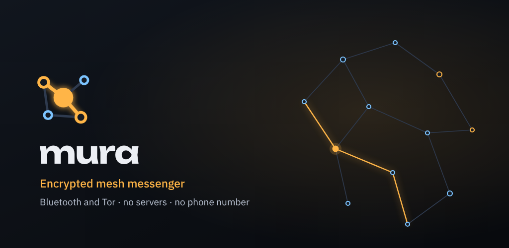
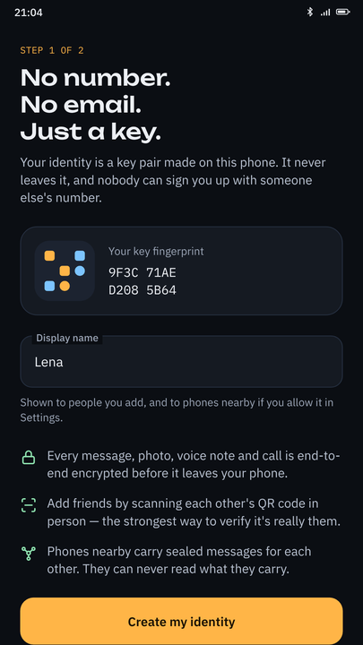
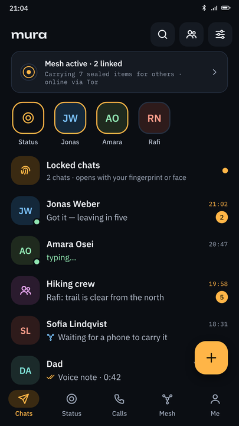
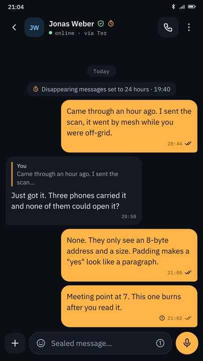
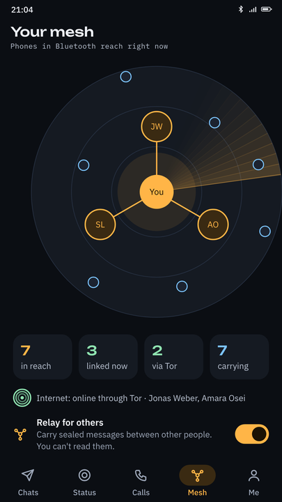
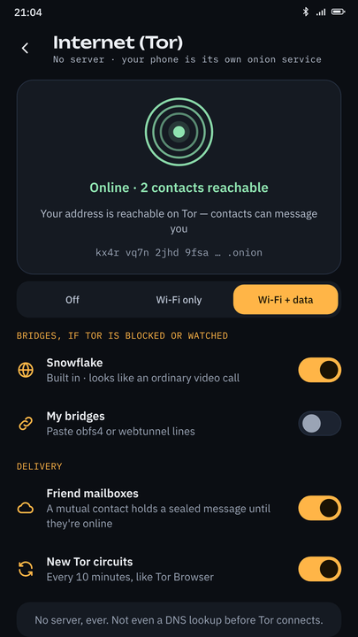
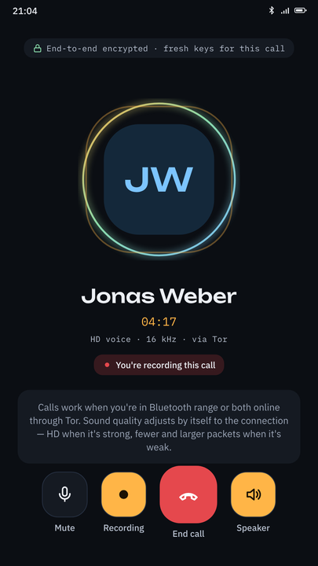
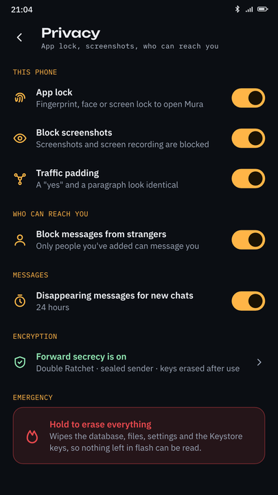
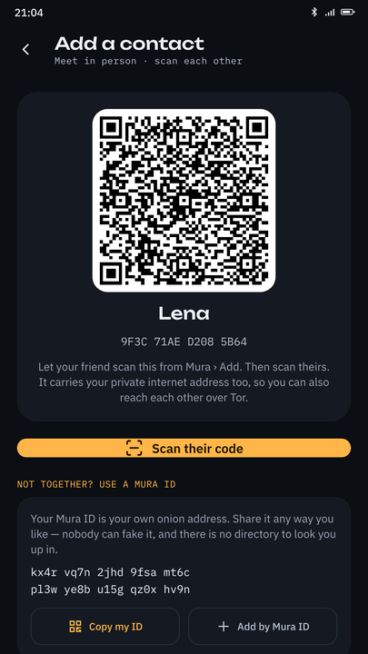

<div align="center">


# Mura

### Open-source encrypted messenger that works with no internet, no servers and no phone number

**End-to-end encrypted chat, files and voice calls over Bluetooth mesh and Tor.
No account. No SIM. No cloud. No company in the middle — not even us.**

[](LICENSE)
[](#system-requirements)
[](CHANGELOG.md)
[](#what-mura-knows-about-you)
[](#no-google-anything)

[Download](#download) · [How it works](#how-mura-actually-works) · [Compared to other apps](#how-mura-differs-from-signal-whatsapp-telegram-session-simplex-and-briar) · [Privacy](#what-mura-knows-about-you) · [Build it yourself](#build-from-source) · [About us](#about-us)



</div>

---

## What is Mura?

**Mura is a free, open-source, serverless private messenger for Android.** It sends
end-to-end encrypted messages, photos, videos, documents, voice notes and voice calls
two ways:

- **Offline, over Bluetooth LE** — phone to phone, with no network of any kind. If your
  contact is out of range, other Mura phones nearby carry the sealed message and pass it
  on until it reaches them. Carriers cannot read what they carry.
- **Online, over Tor** — your phone runs Tor internally and becomes its own onion service.
  No server sits in the middle, and neither phone ever learns the other's IP address.

There is no sign-up. Your identity is a key pair your phone generates and never transmits.
There is no phone number, no email, no username on a registry, no password on a server, and
no server to hold any of it. Nothing about you exists anywhere except on your own device and
on the devices of people you have chosen to talk to.

Mura is built for people who need messaging that keeps working when infrastructure does not:
journalists and their sources, protesters, aid workers, people in places where networks are
filtered or shut down, hikers and sailors out of coverage, and anyone who simply does not
accept that private conversation requires a corporate account.

---

## Screenshots

<div align="center">

| No sign-up at all | Your chats | A conversation |
|:---:|:---:|:---:|
|  |  |  |
| Identity is a key pair made on your phone | Mesh status, locked chats, status updates | Sealed sender, view-once, disappearing |

| The Bluetooth mesh | Online through Tor | Encrypted calls |
|:---:|:---:|:---:|
|  |  |  |
| Phones nearby relay sealed messages | Your phone is its own onion service | Fresh keys for every single call |

| Privacy controls | Adding people |
|:---:|:---:|
|  |  |
| App lock, padding, panic erase | Scan in person, or share a Mura ID |

</div>

---

## Why Mura is open source

**Because you cannot verify a privacy claim you cannot read.**

Every closed-source "private" messenger asks you to take encryption on faith. You are
shown a padlock icon and a marketing page, and you are asked to believe that the app does
what it says, that keys are not escrowed, that nothing is logged, and that no quiet update
has changed any of it. There is no way to check. The padlock is a promise, not a proof.

Encryption has no value if the implementation is hidden. The only honest position for an
app that claims to protect conversations is to publish everything and invite attack:

- **You can audit the cryptography.** Key exchange, the Double Ratchet, the sealed-sender
  envelope, the backup key derivation — all of it is in this repository and all of it can
  be read, criticised and tested by anyone.
- **You can prove there is no backdoor.** Not by trusting us, but by reading the code and
  building it yourself. See [Build from source](#build-from-source).
- **You can prove there is no telemetry.** Search the tree for a network call we have not
  documented. There is no analytics SDK, no crash reporter, no advertising identifier and
  no Firebase. Absence is provable in open source and unprovable in closed source.
- **It survives us.** If DedSec disappeared tomorrow, Mura would not. Anyone can fork it,
  build it, audit it and keep it alive. A closed app dies with its company, and takes its
  users' communications with it.
- **Published bugs get fixed.** A vulnerability you cannot see is not a vulnerability you
  do not have. It is one that only your adversary knows about.

Mura is licensed under the **GNU General Public License v3.0 or later**. That is deliberate:
anyone may use, study, modify and redistribute it, but a modified version must also be
free software with published source. Nobody can take Mura, add tracking, close the source
and ship it to people who think they are getting the private version.

> **Full disclosure, because this matters more than marketing:** Mura has **not** had an
> independent third-party security audit. The cryptography follows well-studied designs and
> is covered by unit tests with known-answer vectors, but review so far has been in-house.
> If your safety depends on this software, please treat that as the warning it is, read the
> code, and help us get it audited. See [SECURITY.md](SECURITY.md).

---

## How Mura actually works

```
                        ┌──────────────────────────────────┐
                        │   Your message, before it moves  │
                        │   ───────────────────────────    │
                        │   Double Ratchet (forward        │
                        │   secrecy) → sealed sender       │
                        │   envelope → padded to a         │
                        │   uniform size                   │
                        └────────────┬─────────────────────┘
                                     │
                     ┌───────────────┴────────────────┐
                     ▼                                ▼
        ┌─────────────────────────┐      ┌──────────────────────────┐
        │  BLUETOOTH LE           │      │  TOR                     │
        │  no network needed      │      │  no server needed        │
        ├─────────────────────────┤      ├──────────────────────────┤
        │  Direct to your contact │      │  Direct onion-to-onion   │
        │  if in range, else      │      │  if both online, else    │
        │  nearby phones carry it │      │  a mutual contact holds  │
        │  and hop it onward      │      │  it as a blind mailbox   │
        └─────────────────────────┘      └──────────────────────────┘
                     └───────────────┬────────────────┘
                                     ▼
                      First path to arrive wins.
                      Duplicates are dropped by bundle id.
```

Both transports run **the same mesh protocol** — an epidemic store-and-forward exchange with
offer/want negotiation, driven by one transport-agnostic router. A Bluetooth link and a Tor
link are both just a `Link` to the router, so a message can start its journey over Bluetooth
and finish it over Tor, or the reverse.

### What a relay can see

A phone carrying someone else's message sees an 8-byte destination hash, a byte count and an
expiry. It cannot see the sender, the recipient, the content, or even the real length — every
payload is padded, so a one-word reply and a long paragraph are indistinguishable on the wire.

### Delivery when you are not online at the same time

Four paths, three of which need no simultaneous presence:

| Path | Needs both online? | How it works |
|---|---|---|
| Direct Bluetooth | No | Delivered the moment you are in range |
| Bluetooth carry | No | Any nearby Mura phone holds it and hops it onward |
| Friend mailbox | No | After 90s undelivered, a mutual contact holds it blind and delivers later |
| Direct Tor | Yes | Onion-to-onion, when both are reachable |

An old phone left plugged in at home running Mura makes an excellent always-on mailbox for
your whole circle, and closes most of the remaining gap. See [docs/FAQ.md](docs/FAQ.md).

Deeper detail: **[docs/ARCHITECTURE.md](docs/ARCHITECTURE.md)** ·
**[docs/TECHNICAL-DETAILS.md](docs/TECHNICAL-DETAILS.md)** ·
**[docs/THREAT-MODEL.md](docs/THREAT-MODEL.md)**

---

## How Mura differs from Signal, WhatsApp, Telegram, Session, SimpleX and Briar

Mura exists because of one gap: **no mainstream private messenger works when the network is
gone.** Signal, WhatsApp, Telegram, Session and SimpleX all stop at the same wall — if there
is no internet, there is no message. Mura's nearest relative is Briar, which also does
Bluetooth and Tor; Mura adds voice calls and a full modern messaging feature set on top.

*Verified November 2026. Other projects change — corrections very welcome by
[issue](../../issues) or pull request.*

| | **Mura** | Signal | WhatsApp | Telegram | Session | SimpleX | Briar |
|---|:---:|:---:|:---:|:---:|:---:|:---:|:---:|
| **Works with no internet (Bluetooth)** | ✅ | ❌ | ❌ | ❌ | ❌ | ❌ | ✅ |
| **Messages relayed by other users' phones** | ✅ | ❌ | ❌ | ❌ | ❌ | ❌ | ✅ |
| **Tor built into the app** | ✅ | ❌ | ❌ | ❌ | own network | via Orbot | ✅ |
| **Voice calls** | ✅ | ✅ | ✅ | ✅ | ✅ | ✅ | ❌ |
| **No phone number** | ✅ | beta¹ | ❌ | ❌ | ✅ | ✅ | ✅ |
| **No operator servers at all** | ✅ | ❌ | ❌ | ❌ | ❌ | self-host | ✅ |
| **E2E encrypted by default** | ✅ | ✅ | ✅ | ❌² | ✅ | ✅ | ✅ |
| **Runs without Google Play Services** | ✅ | ✅ | ❌ | ✅ | ✅ | ✅ | ✅ |
| **Open source** | ✅ | ✅ | ❌ | client only | ✅ | ✅ | ✅ |
| **Licence** | GPL-3.0 | GPL-3.0 | — | GPL-3.0 | GPL-3.0 | AGPL-3.0 | GPL-3.0 |

¹ Signal began testing phone-number-less registration in an Android beta in September 2026
(a one-time US$2.99 fee, Account ID and Account Key). Stable Signal still registers with a
phone number, and you cannot remove the number from an existing account.
[Source](https://www.privacyguides.org/news/2026/09/16/signal-enables-phone-number-less-registration-in-beta/)

² Telegram cloud chats are **not** end-to-end encrypted. Only "Secret Chats" are, they are
opt-in, and they do not sync across devices.

### Said plainly, without the table

**Mura is not trying to replace Signal for everyday use.** Signal is excellent, audited by
people far better than us, and has a decade of hardening. If you want the best-reviewed
private messenger for normal life with normal internet, use Signal.

Mura is for the situation Signal cannot cover. Signal needs a working internet connection and
Signal's servers to be reachable. In a network shutdown, a protest where the local cell site
is throttled, a disaster where the towers are down, or a country where Signal's domains are
blocked and Signal isn't installed, Signal delivers nothing. Mura keeps working, because the
only infrastructure it needs is other phones.

**Compared to Briar**, the honest answer is that Briar got there first and deserves the
credit for proving the design. Briar has had independent security audits and Mura has not.
What Mura adds: encrypted **voice calls** over both transports (Briar has none), groups up to
200, status updates, polls, checklists, file transfer with resume, on-device translation and
voice transcription, an optional disguise mode, and a considerably more conventional
messaging interface. If you want the most-audited offline messenger today, that is Briar.
If you want offline messaging plus calls plus a familiar feature set, that is Mura.

**Compared to Session and SimpleX**, both are genuinely serverless-ish in different ways —
Session routes through its own service-node network, SimpleX through relays you can self-host.
Both are real improvements on Signal's metadata model. Neither works without the internet.

Full discussion with reasoning: **[docs/COMPARISON.md](docs/COMPARISON.md)**

---

## What Mura knows about you

Nothing. There is no mechanism by which it could.

| Data | Collected by Mura? |
|---|---|
| Phone number | Never requested |
| Email address | Never requested |
| Name | Only what you type, shown only to people you add |
| Contact list / address book | Never read |
| Location | Only for a location message you send deliberately; never in the background |
| Message content | End-to-end encrypted; unreadable to anyone but the recipient |
| Who you talk to | Hidden by sealed sender, even from relays |
| Message sizes | Hidden by padding |
| IP address | Hidden by Tor; never exposed to the other phone |
| Analytics / telemetry | None. No SDK, no crash reporter, no advertising ID |
| Cloud backups | None. Backups are encrypted files you place where you choose |

**Permissions and what each is actually for:** see [docs/PRIVACY.md](docs/PRIVACY.md).

### No Google anything

Mura does not link Google Play Services, Firebase, Crashlytics, or any Google library beyond
AndroidX. There is no push notification service, because a push service would mean routing
notification metadata through a third party. Mura holds its own connection instead. This also
means Mura runs perfectly on de-Googled Android — GrapheneOS, CalyxOS, LineageOS, /e/OS.

### Security design at a glance

| Layer | Primitive |
|---|---|
| Identity | X25519 (exchange) + Ed25519 (signing), generated on device |
| 1:1 messages | Double Ratchet — forward secrecy and post-compromise security |
| Groups | Hash-ratcheted sender keys, up to 200 members |
| Calls | One-time keys, discarded when the call ends |
| Transport sealing | Sealed sender — relays never learn the author |
| Payload | AES-256-GCM, HKDF-derived keys, uniform padding |
| At rest | Database and files encrypted under an Android hardware Keystore key |
| Backups | PBKDF2-SHA256, 310,000 iterations, AES-256-GCM, fresh key per file |
| Emergency | Panic erase wipes database, files, settings and Keystore keys |

---

## Honest limitations

A privacy project that hides its weak points is not being honest with you.

- **No independent audit yet.** In-house review and unit tests only.
- **Bluetooth is slow.** Roughly 10–60 KB/s per hop. A compressed video takes minutes per hop.
- **Tor calls have delay.** A six-hop onion circuit adds noticeable latency to voice.
- **Video calls are not practical** over either transport at these bandwidths and latencies.
- **Global reach needs a path.** Messages spread along the graph of people who know each
  other's addresses. There is no directory of strangers, by design — which also means no
  stranger can enumerate or find you.
- **Mura must keep running to receive.** There is no push server. Allow background running.
- **Mura cannot moderate anything.** It cannot read content, so it cannot police it. You get
  blocking, stranger filters and deletion; there is nobody to report to, because there is no
  operator with visibility.
- **It is not magic.** It protects messages in transit and at rest. It cannot protect you
  from a compromised phone, a keylogger, a camera over your shoulder, or someone with your
  unlocked device.

---

## Download

> **Replace the links below once you publish your first release.**
> Until a signed release exists, [Build from source](#build-from-source) is the only path —
> and honestly the best one, because you then know exactly what you are running.

| Source | Status |
|---|---|
| **GitHub Releases** | [Latest release](../../releases/latest) — signed APK + `SHA256SUMS` |
| **F-Droid** | *planned* — reproducible builds from this repository |
| **Google Play** | *planned* |
| **Build it yourself** | [Instructions below](#build-from-source) |

**Never install Mura from a mirror, APK aggregator or Telegram channel.** A tampered build of
a privacy app is worse than no privacy app. Verify the signature of anything you install:

```bash
# confirm the APK's signing certificate before installing
apksigner verify --print-certs Mura-2.7.9.apk
sha256sum -c SHA256SUMS
```

### System requirements

- Android 9 (API 28) or newer
- Bluetooth Low Energy (required — Mura cannot work without it)
- About 60 MB free, plus whatever you lend to the mesh (200 MB by default, adjustable)
- No Google account, no Google Play Services, no SIM card

---

## Build from source

```bash
git clone https://github.com/officialdedsec/mura-messenger.git
cd mura
./gradlew assembleDebug          # debug APK, installable immediately
./gradlew test                   # crypto vectors, ratchet, groups, backup, store-and-forward
./gradlew bundleRelease          # release AAB (needs a signing key, see docs/BUILDING.md)
```

Requirements: JDK 17, Android SDK with API 36, and about 4 GB of free disk. No Android Studio
needed; the Gradle wrapper is included.

Full instructions, signing setup, reproducible-build notes and the 16 KB page-size check:
**[docs/BUILDING.md](docs/BUILDING.md)**

---

## Contributing

Pull requests are welcome, and review of the cryptography is welcome most of all.

- Found a security flaw? **Do not open a public issue.** Read [SECURITY.md](SECURITY.md).
- Want to help? Good first areas: translations, accessibility, battery profiling, protocol
  fuzzing, and independent audit of the ratchet and sealed-sender implementations.
- Please read [CONTRIBUTING.md](CONTRIBUTING.md) and [CODE_OF_CONDUCT.md](CODE_OF_CONDUCT.md).

By contributing you agree your work is licensed GPL-3.0-or-later.

---

## About us

**Mura is built by the DedSec Cyber Security Research Institute.**

We are a small independent security research group. We work on reverse engineering, malware
analysis, vulnerability research and defensive security tooling, and Mura came out of a
straightforward question: what would a messenger look like if you removed every component
that could be subpoenaed, seized, sold, bribed or switched off?

The answer turned out to be that you remove the servers entirely — and once there is no
server, there is no account, no phone number, no directory, no metadata pile and nothing for
anyone to demand from us, because we hold nothing. We cannot read your messages, we cannot
tell anyone who you talk to, and we cannot be compelled to hand over something that does not
exist. That is not a policy promise. It is an architectural fact, and you can verify it in
this repository.

We make no money from Mura. There are no ads, no subscriptions, no premium tier, no venture
funding and no data to sell. It is free software in both senses.

| | |
|---|---|
| **Website** | [dedseec.com](https://www.dedseec.com) |
| **Privacy policy** | [dedseec.com/privacy-policy-and-disclaimer](https://www.dedseec.com/privacy-policy-and-disclaimer/) |
| **Security contact** | see [SECURITY.md](SECURITY.md) |
| **General contact** | *add your public contact address here* |

More: **[docs/ABOUT.md](docs/ABOUT.md)**

---

## License

Mura is free software licensed under the **GNU General Public License v3.0 or later**.
See [LICENSE](LICENSE).

This program is distributed in the hope that it will be useful, but **WITHOUT ANY WARRANTY**;
without even the implied warranty of MERCHANTABILITY or FITNESS FOR A PARTICULAR PURPOSE.

Third-party components and their licences are listed in
[docs/THIRD-PARTY-LICENSES.md](docs/THIRD-PARTY-LICENSES.md). Mura bundles Tor
(BSD 3-Clause) and uses AndroidX, Tink and ZXing (Apache 2.0) among others.

**Tor** is a trademark of The Tor Project, Inc. Mura uses Tor but is not affiliated with,
endorsed by, or a product of The Tor Project.

---

<div align="center">

**Private messaging should not require permission from anyone.**

*Open-source encrypted messenger · Bluetooth mesh networking · Tor onion services ·
offline messaging · serverless peer-to-peer chat · no phone number · anonymous messaging ·
off-grid communication · censorship-resistant messaging · decentralized messenger for Android*

</div>
